# Romeo's Pizza Nigeria — System Architecture & Connection Map

This document details how every component, page, script, API handler, database integration, and stylesheet in the Romeo's Pizza Nigeria web platform connects and communicates.

---

## 1. High-Level System Connection Diagram

```mermaid
flowchart TD
    subgraph ClientPages["Customer Facing HTML Pages (Port 3000)"]
        P_HOME["index.html<br/>(Home & Preview + Nav Cart)"]
        P_MENU["890b.html<br/>(Full 13-Pizza Menu + Nav Cart)"]
        P_DEALS["pizzadeals.html<br/>(Deals & Combos + Nav Cart)"]
        P_ORDER["order.html<br/>(Cart, 12m Cancel & Checkout)"]
        P_TRACK["track.html<br/>(Live Tracking & 12m Cancel)"]
        P_PRIVACY["privacy.html<br/>(NDPA 2023 Policy)"]
        P_TERMS["terms.html<br/>(Terms & Conditions)"]
    end

    subgraph SeparateConsole["Separately Hosted Verification Console (Port 4000)"]
        C_SERVER["admin-console/server.js<br/>(Standalone HTTP Host + API Proxy)"]
        C_UI["admin-console/index.html & admin.html<br/>(Locked 14-Char Login · Admin vs Staff RBAC)"]
    end

    subgraph Styles["Global Stylesheet"]
        CSS["peter890.css<br/>(Variables, Layout, Animations, Light/Dark Themes)"]
    end

    subgraph ClientJS["Client-Side Script Layer (js/)"]
        JS_SITE["js/site.js<br/>• Live Search Filter<br/>• ThemeController (Light/Dark)<br/>• Cross-Tab Theme Sync"]
        JS_CART["js/cart.js<br/>• Global Cart Sync<br/>• Counter Badges<br/>• Quantity Control (1–10)"]
        JS_DEALS["js/deals-interactive.js<br/>• Deals Flavor Pull-Downs<br/>• 39-Price Size Engine<br/>• Combo Title Builder"]
        JS_ORDER["js/order.js<br/>• Pricing Engine & ITEM_PRICES<br/>• ₦800 Flat Service Fee<br/>• 15% Delivery Fee<br/>• WhatsApp Receipt Builder<br/>• Checkout Form Handler"]
    end

    subgraph BrowserStorage["Browser Client State"]
        STORAGE_CART["localStorage['romeos_cart']<br/>localStorage['romeos-pizza-cart']"]
        STORAGE_THEME["localStorage['romeos-theme']"]
        BC_CART["BroadcastChannel<br/>('romeos_cart_channel')"]
        BC_THEME["BroadcastChannel<br/>('romeos_theme_channel')"]
    end

    subgraph ServerLayer["Backend API Layer (api/ & Server)"]
        DEV_SERVER["dev-server.js<br/>(Local Node HTTP Server on Port 3000)<br/>• Path Traversal Guard<br/>• Zero Hard-Coded Secrets"]
        API_ORDERS["api/orders.js<br/>(Vercel Serverless Function)<br/>• POST: Validates & Normalizes<br/>• GET ?diagnostics=1: Recipient Check"]
        API_TRACK["api/track.js<br/>(Order Tracking)<br/>• GET/POST: Phone + PIN Lookup<br/>• 5-Step Order Lifecycle"]
        API_PIN["api/pin-manager.js<br/>(6-Digit Order PIN Manager)<br/>• 5-Day Non-Recycling Retention<br/>• Atomic DB + In-Memory Fallback"]
        API_ADMIN["api/admin.js<br/>(RBAC Order Console API)<br/>• POST: 14-Char Username/Password Login<br/>• GET/PATCH/DELETE: Role-Locked RBAC"]
        API_DB["api/db.js<br/>(Database Connector)<br/>• insertOrder()<br/>• allocatePin()<br/>• findOrderForTracking()<br/>• updateOrderStatus()"]
        PRICES_JSON["prices.json<br/>(Single Source of Truth)"]
    end

    subgraph ExternalServices["External Endpoints & Databases"]
        WA_API["WhatsApp Business Direct Chat<br/>wa.me/2349055303848<br/>(Itemized Receipt & Payment Summary)"]
        DB_SUPABASE["Supabase REST API<br/>(PostgreSQL Orders Table)"]
        DB_NEON["Neon Serverless PostgreSQL<br/>(Fallback Orders Table)"]
    end

    %% Stylesheet connections
    P_HOME --> CSS
    P_MENU --> CSS
    P_DEALS --> CSS
    P_ORDER --> CSS
    P_TRACK --> CSS
    P_PRIVACY --> CSS
    P_TERMS --> CSS

    %% Page Script bindings
    P_HOME --> JS_SITE
    P_HOME --> JS_CART

    P_MENU --> JS_SITE
    P_MENU --> JS_CART
    P_MENU --> JS_DEALS

    P_DEALS --> JS_SITE
    P_DEALS --> JS_CART
    P_DEALS --> JS_DEALS

    P_ORDER --> JS_SITE
    P_ORDER --> JS_CART
    P_ORDER --> JS_ORDER

    P_PRIVACY --> JS_SITE
    P_PRIVACY --> JS_CART

    P_TERMS --> JS_SITE
    P_TERMS --> JS_CART

    %% Cross-script dependencies
    JS_DEALS -.->|reads pricing & formats| JS_ORDER
    JS_ORDER -.->|mirrors state| JS_CART

    %% Browser state connections
    JS_SITE <--> STORAGE_THEME
    JS_SITE <--> BC_THEME

    JS_CART <--> STORAGE_CART
    JS_CART <--> BC_CART

    JS_DEALS <--> STORAGE_CART
    JS_ORDER <--> STORAGE_CART

    %% API connections
    P_ORDER --"POST /api/orders (JSON)"--> API_ORDERS
    DEV_SERVER --> API_ORDERS
    DEV_SERVER --> API_ADMIN

    API_ORDERS --"uses pricing calculation"--> JS_ORDER
    API_ORDERS --> API_DB
    API_ADMIN --> API_DB

    %% External handoffs
    API_ORDERS --"returns wa.me URL"--> P_ORDER
    P_ORDER --"window.open"--> WA_API
    API_DB --> DB_SUPABASE
    API_DB --> DB_NEON
```



---

## 2. Interactive Data Flows

### Flow A: Multi-Page Cart & Cross-Tab Synchronization
```
[User clicks '+' or '−' button on any page]
    │
    ▼
[DOM Event Listener in js/cart.js or js/order.js]
    │
    ├── 1. Updates in-memory cart object (quantities clamped 1–10)
    ├── 2. Writes to localStorage['romeos_cart'] (JSON array: [{name, quantity}])
    ├── 3. Writes to localStorage['romeos-pizza-cart'] (Legacy map: {name: quantity})
    ├── 4. Broadcasts message on BroadcastChannel('romeos_cart_channel')
    └── 5. Dispatches CustomEvent('cart:change') on document
            │
            ▼
[All open browser tabs & pages catch the broadcast]
    ├── Updates cart badge (#cart-count) in header
    ├── Updates addon card styles (.checkout-addon-card.is-in-cart)
    └── On order.html: recalculates subtotal, fees, and grand total in real time
```

---

### Flow B: Deals & Dynamic Pizza Size Selection
```
[User visits pizzadeals.html or 890b.html]
    │
    ├── Deals Combos:
    │     User changes 'Pizza 1' or 'Pizza 2' pull-down select
    │     ├── js/deals-interactive.js resolves composite name:
    │     │   e.g., "The Festive Box (Pepperoni Pizza + BBQ Chicken Pizza)"
    │     ├── Updates quantity control data-cart-item attribute
    │     └── Reads current cart quantity for that exact composite selection
    │
    └── Individual Menu Pizzas:
          User selects size (Medium 10" / Large 12" / Champion 16")
          ├── js/deals-interactive.js maps pizza to category (Traditional, Special, Exclusive)
          ├── Resolves live price from PIZZA_PRICES dictionary
          ├── Updates visible price tag (e.g., "₦14,150")
          └── Updates data-cart-item to "Pizza Name (Size)"
```

---

### Flow C: Checkout, Pricing Calculation & WhatsApp Order Dispatch
```
[User fills checkout form on order.html and clicks 'Continue to WhatsApp']
    │
    ├── 1. Client-side Validation (js/order.js):
    │     • Name length >= 2 chars
    │     • Phone number valid Nigerian format (normalized to E.164: +234...)
    │     • Delivery address length >= 5 chars (waived for Pickup)
    │     • Location selected from valid list
    │     • Mandatory legal consent checked (terms.html & privacy.html)
    │     • At least 1 item in cart or custom items text entered
    │
    ├── 2. Pricing Engine Execution (calculateOrderTotals):
    │     • Subtotal: sum(item_price * quantity)
    │     • Service Fee: flat ₦800 (if item count > 0)
    │     • Delivery Fee: Math.round(subtotal * 0.15) if Delivery; ₦0 for Pickup
    │     • Grand Total: subtotal + serviceFee + deliveryFee
    │     • NOTE: The 15% formula is hidden; customer sees only the exact Naira amount
    │
    ├── 3. Pre-opens blank tab synchronously (avoids Safari/Chrome popup blockers)
    │
    ├── 4. Async Dispatch to Serverless API:
    │     POST /api/orders
    │     ├── api/orders.js re-validates payload server-side
    │     ├── Calculates pricing using calculateOrderTotals() from js/order.js
    │     ├── Formats structured WhatsApp Markdown message
    │     ├── Asynchronously stores record via api/db.js (Supabase / Neon)
    │     └── Returns { whatsappUrl: "https://wa.me/2349055303848?text=...", orderId, pricing }
    │
    ├── 5. Browser redirects pre-opened tab to whatsappUrl
    │
    └── 6. Confirmation Screen on order.html displays itemized receipt, order ref,
          fallback clickable link, and an 'Edit Order' button to return if needed
```

---

### Flow D: Theme Controller (Dark / Light Mode)
```
[User clicks #theme-toggle button in navigation]
    │
    ▼
[ThemeController.toggleTheme() in js/site.js]
    │
    ├── 1. Toggles data-theme attribute on <html> element: 'dark' <-> 'light'
    ├── 2. Updates <meta name="theme-color"> (#161114 for dark, #5C1A2B for light)
    ├── 3. Updates aria-pressed and toggles icon class (fa-moon <-> fa-sun)
    ├── 4. Persists setting in localStorage['romeos-theme']
    ├── 5. Broadcasts across tabs via BroadcastChannel('romeos_theme_channel')
    └── 6. peter890.css re-renders colors via CSS custom properties
```

---

## 3. Component & File Connection Matrix

| File Path | Role | Inbound Connections (Who calls/includes it) | Outbound Connections (What it calls/uses) |
| :--- | :--- | :--- | :--- |
| **`index.html`** | Landing page & quick preview | Direct visitor entry, nav links from all pages | `peter890.css`, `js/site.js`, `js/cart.js`, `images/`, `890b.html`, `pizzadeals.html`, `order.html`, `privacy.html`, `terms.html` |
| **`890b.html`** | Full menu with 13 pizzas, 3 sizes, sides & deals | Links from `index.html`, `order.html`, footers | `peter890.css`, `js/site.js`, `js/cart.js`, `js/deals-interactive.js`, `order.html?item=...`, `privacy.html`, `terms.html` |
| **`pizzadeals.html`** | Deals & combos with interactive flavor pickers | Links from `index.html`, `890b.html`, footers | `peter890.css`, `js/site.js`, `js/cart.js`, `js/deals-interactive.js`, `privacy.html`, `terms.html` |
| **`order.html`** | Live cart, sides addons, and checkout form | Links from `index.html`, `890b.html`, `pizzadeals.html` | `peter890.css`, `js/site.js`, `js/cart.js`, `js/order.js`, `api/orders.js`, `track.html`, `privacy.html`, `terms.html` |
| **`track.html`** | Customer order tracking by Phone + 6-digit PIN | Nav/footer links from all pages, order confirmation link | `peter890.css`, `js/site.js`, `api/track.js`, `privacy.html`, `terms.html` |
| **`privacy.html`** | NDPA 2023 legal privacy policy | Footers of all pages, checkout consent link | `peter890.css`, `js/site.js`, `js/cart.js`, `terms.html` |
| **`terms.html`** | Terms & Conditions (cancellations, fees) | Footers of all pages, checkout consent link | `peter890.css`, `js/site.js`, `js/cart.js`, `privacy.html` |
| **`peter890.css`** | Unified stylesheet for the entire application | Included in `<head>` by all 7 HTML pages | CSS variables (`:root`, `[data-theme="dark"]`), responsive media queries |
| **`prices.json`** | Canonical Single Source of Truth for pricing | Consulted by pricing engines & test suites | 4 tiers, 3 sizes, combos, sides/drinks, fee constants |
| **`js/site.js`** | Search filtering & ThemeController | Included via `<script defer>` on all 7 pages | `localStorage['romeos-theme']`, `BroadcastChannel('romeos_theme_channel')` |
| **`js/cart.js`** | Multi-page cart state & counter manager | Included via `<script defer>` on all 7 pages | `localStorage['romeos_cart']`, `BroadcastChannel('romeos_cart_channel')` |
| **`js/deals-interactive.js`**| Deals & pizza pull-down flavor selectors, Half & Half visual preview | Included on `890b.html` and `pizzadeals.html` | `window.RomeosCart`, `js/order.js` (for pricing verification), `localStorage` |
| **`js/order.js`** | Checkout engine, pricing formula & receipt builder | Included on `order.html`, imported by `api/orders.js` | `window.RomeosCart`, `/api/orders`, `wa.me/2349055303848`, `module.exports` |
| **`api/orders.js`** | Serverless order validation & receipt endpoint | Called via `POST` & `GET` by `order.html` & dev-server | `js/order.js` (`calculateOrderTotals`), `api/pin-manager.js` (`allocateOrderPin`), `api/db.js` (`insertOrder`) |
| **`api/track.js`** | Serverless tracking & 12-min cancel API | Called via `GET`/`POST`/`DELETE` by `track.html` & `order.html` | `api/db.js` (`findOrderForTracking`, `updateOrderStatus`), enforces 12-min cancellation window |
| **`api/pin-manager.js`** | 6-digit random Order PIN generator | Required by `api/orders.js` | Enforces 5-day non-recycling retention via atomic DB allocation or `/tmp/romeos-active-order-pins.json` |
| **`api/db.js`** | Multi-driver database abstraction & local store | Imported by `api/orders.js`, `api/track.js`, `api/admin.js` | Supabase REST API, Neon PostgreSQL, local `/tmp/romeos-orders-store.json` fallback |
| **`api/admin.js`** | RBAC Console API (POST login, GET, PATCH, DELETE) | Called by `admin-console/` & `admin.html` with CORS | Timing-safe 14-char alphanumeric auth, HMAC tokens, PII masking & state-only lock for `staff` |
| **`admin-console/`** | Separately hosted locked Verification Console | Run via `npm run start:console` or standalone Vercel deploy | Serves locked 14-char login UI on port 4000, proxies/calls `/api/admin` |
| **`dev-server.js`** | Zero-dependency local development server | Run via `npm start` or `node dev-server.js` | Serves static files, path traversal guard, routes `/api/orders`, `/api/admin`, `/api/track` |
| **`scripts/verify-all.js`** | Automated 81-test verification suite | Run via `npm test` or `node scripts/verify-all.js` | Tests all HTML, JS, CSS, navbar cart badge, RBAC auth, 12-min cancel, PIN retention & legal links |
| **`scripts/stress-test.js`** | 5-round adversarial stress test suite | Run via `node scripts/stress-test.js` | Fuzzing, concurrency (100 PINs), 507 Half & Half permutations, RBAC, 12m cancel & 5d retention |

---

## 4. Fee & Pricing Formula Specifications

All prices and calculations are standardized across client and server:

* **Subtotal**: Sum of `item_price × quantity` for all cart items.
* **Service Fee**: Flat **₦800** when cart item count > 0; ₦0 for empty carts.
* **Delivery Fee**: **15%** of subtotal (`Math.round(subtotal * 0.15)`) for Delivery orders; **₦0 (Free Pickup)** for Pickup orders.
  * *UI Disclosure Rule*: The percentage formula (`15%`) is strictly internal and never shown in customer receipts or UI. Only the exact calculated Naira amount (e.g. `Delivery Fee: ₦2,123`) is displayed.
* **Grand Total**: `Subtotal + Service Fee + Delivery Fee`.
* **WhatsApp Recipient**: `2349055303848` (`09055303848`).

---

## 5. Verification & Testing

To verify that all connections, files, endpoints, fee logic, and legal requirements remain in working order:

```bash
npm test
# Or: node scripts/verify-all.js
```

All 108 automated checks test syntax, assets, pizza sizing, pricing engines, navbar cart icon, API endpoints, RBAC auth, 12-minute cancel window, theme controls, order tracking, and legal compliance.

To run the 5-round adversarial stress testing suite:

```bash
node scripts/stress-test.js
```


---

## 6. Redis Login Store, Load Balancer & UI Architecture (2026-11-21)

### Redis Login Store (`api/redis.js`)
- Backs `api/auth.js` (customer logins) and `api/admin.js` (admin/staff/driver console logins) with **Upstash Redis REST** (`UPSTASH_REDIS_REST_URL` / `UPSTASH_REDIS_REST_TOKEN`) and an automatic local in-memory fallback when Redis env vars are unset.
- Stores active session `jti` records, enforces instant logout revocation (`revokeSession` / `isSessionRevoked`), tracks distributed per-IP login rate limits, and locks out repeated failed login attempts (`recordFailedLogin` / `isLoginLockedOut`).

### Load Balancer & Cluster Failover (`api/load-balancer.js`, `dev-server.js`)
- `createLoadBalancerPool()` distributes API traffic across configured upstream nodes using `least-connections` or `round-robin` strategies.
- Tracks per-node latency, consecutive errors, circuit-breaker cooldowns, and automatic retry failover (`executeWithFailover`).
- `dev-server.js` supports multi-worker Node.js `cluster` mode (`CLUSTER_WORKERS`) and upstream reverse-proxy forwarding (`LOAD_BALANCER_UPSTREAMS`).

### Design System & Three-Dots Navigation
- **Palette:** Berry & Cream (Light: `#FFF8F5` / `#8C1D40` / `#5C1A2B`, Dark: `#150B0E` / `#F0708F` / `#2A0F18`) across storefront (`peter890.css`), Admin Console (`admin.html`, `admin-console/index.html`), and Driver Console (`driver.html`, `driver-console/index.html`).
- **Typography & Craft (`human-made`):** `Fraunces` display headings with optical negative tracking, `Plus Jakarta Sans` body UI, `JetBrains Mono` for order references/PINs/refund tokens, tabular numerals on all currency values, `<= 8px` card/popover radii, zero emojis in UI chrome, and unframed operational ledger sections.
- **Three-Dots (`⋮`) Navigation:**
  - **Client Storefront:** `#nav-dots-toggle` (`fa-ellipsis-vertical`) toggles `#nav-links-menu` via `window.DotsMenuController` in `js/site.js` with `Escape` and outside-click dismissal.
  - **Admin Console:** `#admin-dots-toggle` in `.console-header-actions` toggles `#admin-dots-menu`, housing all console section tabs (`.console-nav-tabs`), live count badges, page links (`/feedback`, `/refunds`, `/driver`), CSV export, refresh, and lock/logout controls.
